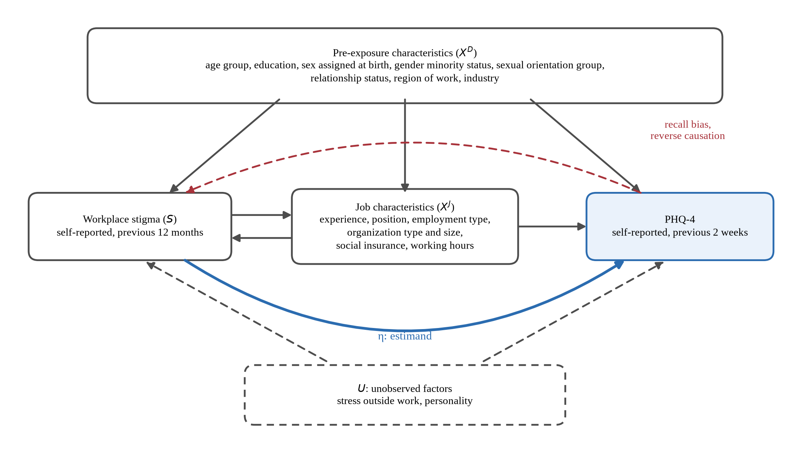
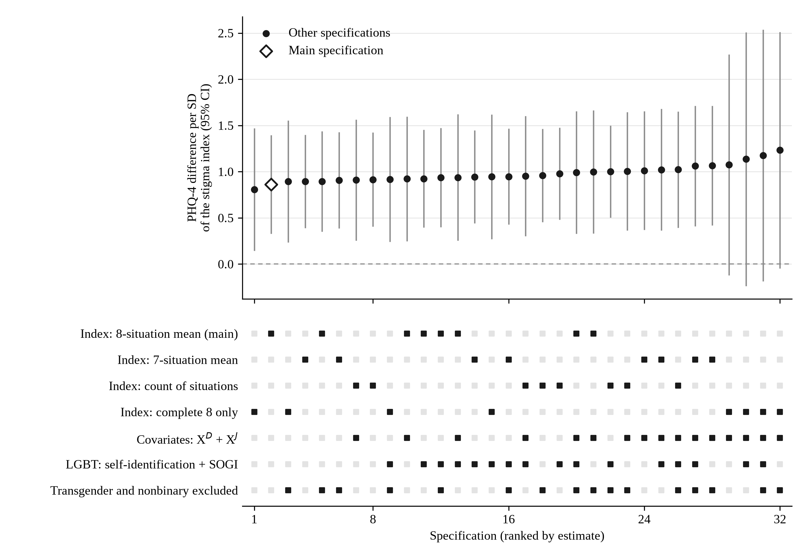

RESEARCH

# Pathology or Prejudice? Workplace Stigma and Mental Health among LGBT Workers in Vietnam

[Author names]¹

¹ Banking Academy of Vietnam, Hanoi, Vietnam

Corresponding author: [name, email]

---

## Abstract

**Introduction** Sexual and gender minority adults report more anxiety and depression than other adults, but such disparities cannot show whether distress originates in identity or in prejudice. Minority stress theory predicts that minority group members who experience more stigma report more symptoms. We examined which forms of workplace stigma LGBT workers in Vietnam experience and how these forms relate to symptoms.

**Methods** In a cross-sectional survey, 235 LGBT workers reported how often they had experienced eight stigmatizing situations at work during the previous 12 months and completed the PHQ-4. Models adjusted for eight groups of pre-exposure characteristics.

**Results** More than half of participants (57.0%) reported at least one situation. Interpersonal stigma was the most common form (47.2%), particularly unwanted personal questions (33.9%) and offensive jokes (26.8%), whereas career-related (17.4%) and gender expression stigma (18.0%) were less common. A one-unit difference in the stigma index was associated with PHQ-4 scores 1.85 points higher (95% CI [0.71, 2.99]), and the estimate was positive in all 32 specifications. The association was clear for interpersonal stigma and inconclusive for the other forms.

**Conclusion** Symptoms varied with exposure to stigma within the group, a gradient predicted by minority stress theory but not by an identity-based account, although the cross-sectional design does not establish its direction.

**Policy Implications** Elevated symptoms among LGBT workers should not be read as evidence of pathology. Naming sexual orientation and gender identity in the Labor Code, and workplace rules against derogatory jokes and intrusive questions, would address the forms of stigma that LGBT workers most often report.

**Keywords** Minority stress · Workplace stigma · Enacted stigma · LGBT workers · Anxiety · Depression · Vietnam

---

## Introduction

Sexual minority adults report higher rates of depression and anxiety disorders than heterosexual adults (King et al., 2008; Plöderl & Tremblay, 2015), and bisexual people report higher rates than both heterosexual and gay or lesbian people (Ross et al., 2018). A difference in rates, however, does not identify its source. One interpretation treats sexual or gender minority identity as the origin of psychological distress, whereas the other treats distress as a consequence of the way in which societies treat people who hold these identities (I. H. Meyer, 2003).

The first interpretation has lost its scientific standing. Homosexuality was removed from the diagnostic manual of the American Psychiatric Association in 1973 (Drescher, 2015), and the eleventh revision of the International Classification of Diseases moved gender incongruence out of the chapter on mental disorders (World Health Organization, 2019). Pathologizing views nevertheless persist in social life, including in Vietnam, where school lessons have been documented as presenting same-sex attraction as a mental disorder that can be cured (Human Rights Watch, 2020) and where the Ministry of Health instructed medical facilities in 2022 not to regard homosexuality, bisexuality, or being transgender as illnesses (Ministry of Health of Vietnam, 2022). In such a setting, evidence that LGBT people report more distress can easily be absorbed into the very prejudice that may contribute to that distress.

The workplace is a particularly informative setting in which to examine this question. Adults spend a large share of their waking time at work, interact repeatedly with the same colleagues and supervisors, and cannot easily avoid them. Workplaces also translate prejudice into decisions about assignments, evaluation, and pay. In Vietnam, the Labor Code prohibits employment discrimination on a list of grounds that does not include sexual orientation or gender identity (National Assembly of Vietnam, 2019), so the protection available to LGBT workers depends largely on their employers. However, little is known about which forms of stigma LGBT workers in Vietnam encounter at work or about how these experiences relate to their mental health. Research is therefore needed to describe these experiences and to examine their association with symptoms of anxiety and depression.

### Workplace Stigma and Minority Stress

Link and Phelan (2001) define stigma as the co-occurrence of labeling, stereotyping, separation, status loss, and discrimination in a situation in which power is exercised, so discrimination is one component of a broader process. The current study uses the concept of enacted stigma, which we define as workplace behaviors and conditions that target, or are based on, a worker's sexual orientation, gender identity, or gender expression and that demean, intrude upon, or disadvantage the worker. The minority stress model (I. H. Meyer, 1995, 2003) proposes that such experiences contribute to poorer mental health among sexual minority people because they live in a society that stigmatizes their identities. The model distinguishes distal stressors, such as discrimination and harassment, from proximal stressors, such as expectations of rejection, concealment, and internalized stigma, and it assigns coping and social support a role in altering the link between stress and health. Hatzenbuehler (2009) added that stigma-related stress may impair emotion regulation, interpersonal functioning, and cognition, which in turn may lead to psychopathology. Later work extended the model to structural stigma (Hatzenbuehler, 2016; Hatzenbuehler et al., 2010; Pachankis & Bränström, 2018) and to transgender and gender nonconforming people (Hendricks & Testa, 2012), and it emphasized that minority stress processes should be examined across different social and policy contexts (Frost & Meyer, 2023).

The model yields three types of prediction. At the population level, minority groups should report more symptoms than majority groups. Within a minority group, members exposed to more distal stressors should report more symptoms than other members. Finally, proximal stressors should lie on the path between distal stressors and symptoms. A test of the first prediction requires an equivalently recruited comparison group, and a test of the third requires temporally ordered data, because cross-sectional estimates of mediation can be substantially biased (Maxwell & Cole, 2007). A test of the second prediction requires only variation in exposure within the group. This prediction is also the one that distinguishes the two interpretations described above, because both interpretations predict a disparity between groups, but only the prejudice interpretation predicts that symptoms will vary with exposure to stigma among people who share an LGBT identity. An identity-based account, which locates distress in a characteristic that all members of the group share, offers no reason to expect such a gradient. A gradient would not, however, rule out rival explanations, such as the possibility that people with more symptoms recall more negative events or that a third factor shapes both.

Evidence for a gradient within minority groups is stronger for concurrent than for prospective associations. Across stigmatized groups, people who report more discrimination also report poorer well-being (Lewis et al., 2015), with an average correlation of *r* = −.23 in the meta-analysis of Schmitt et al. (2014). In the same meta-analysis, the association remained negative in longitudinal studies that controlled for earlier well-being (*r* = −.15). Prospective studies of sexual and gender minority people have produced mixed results. Experiences of sexual orientation discrimination have predicted increases in symptoms of depression and anxiety six months later (Dyar et al., 2020, as cited in Herry & Dyar, 2025), whereas an eight-year study of sexual minority people assigned male at birth found that distal stressors were associated with concurrent symptoms but did not predict later change (Pachankis et al., 2018, as cited in Herry & Dyar, 2025). A cross-sectional gradient can therefore establish that stigma and symptoms co-occur, but it cannot establish their temporal order.

Research on minority stress in the workplace has been consistent in direction but limited in design and context. Heterosexism and discrimination at work have been associated with greater psychological distress among lesbian, gay, and bisexual workers in the United States (Velez et al., 2013; Waldo, 1999). A recent systematic review identified 32 studies of 8,369 LGBTQ+ workers, of which 30 were cross-sectional; most of these studies compared LGBTQ+ workers with other workers, and internalized stigma, heterosexism, job stress, and low income were associated with poorer mental health in some groups (Tomic et al., 2025). Studies of variation within LGBTQ+ workforces are fewer; a Canadian survey of 531 LGBTQ workers, for example, examined how precarious employment, industry, and perceived workplace support for LGBTQ people relate to self-reported mental health (Owens et al., 2022). In one of the few studies from Asia, discrimination and other minority stressors among 706 Chinese LGBTQ employees were associated with less favorable perceptions of workplace climate, which were in turn associated with more depressive symptoms, although anxiety was not examined (Lo et al., 2025).

### Forms of Workplace Stigma

Several features of the workplace may change the way in which distal stressors operate. Interaction at work is repeated and difficult to avoid, and leaving a stigmatizing workplace means losing income. Organizations allocate resources hierarchically, so the prejudice of a decision maker can become a formal disadvantage. Organizations can also sanction or tolerate stigma, and gay and lesbian employees have reported less discrimination in organizations with supportive policies and practices (Ragins & Cornwell, 2001). Stigma at work need not take a formal shape, however. In a field study, job applicants presented as gay were not treated differently in formal terms, but they received more negative interpersonal responses (Hebl et al., 2002).

On the basis of this literature, the current study distinguishes three forms of enacted stigma. Interpersonal stigma comprises derogation, such as offensive jokes and comments, which partly overlaps with the microaggressions reviewed by Nadal et al. (2016), and intrusion into privacy, including unwanted personal questions and disclosure of a worker's identity without consent. Career-related stigma comprises formal discrimination in training, evaluation, pay, and work assignments. Gender expression stigma comprises pressure to conform to gender stereotypes and barriers to the expression of gender identity, such as difficulty in using one's name, pronouns, dress, or restroom. Of these three forms, only career-related stigma corresponds to discrimination as it is defined in Vietnam's Labor Code (National Assembly of Vietnam, 2019).

The three forms differ in ways that matter for both measurement and policy. Interpersonal events are recognizable when they occur, because an offensive joke carries its stigmatizing content within itself. A decision about training or pay, by contrast, counts as stigma only if the worker attributes it to their sexual orientation or gender identity, and self-reports of this kind may be more open to the influence of mood and expectations (Lewis et al., 2015). The forms may also differ in their association with distress. In the experimental studies reviewed by Schmitt et al. (2014), manipulating general perceptions of discrimination lowered well-being, whereas attributing a single negative event to discrimination did not, which suggests that frequent everyday events may matter more than rare decisions. A summed score cannot show which forms workers encounter most often or which forms carry an association with symptoms, yet laws and workplace rules address specific behaviors rather than a total score.

### Workplace Stigma in the Vietnamese Context

Vietnam's legal treatment of LGBT people combines elements that point in different directions. The health sector has rejected the pathologizing view (Ministry of Health of Vietnam, 2022), and the Civil Code recognizes gender transition while leaving its regulation to a separate law (National Assembly of Vietnam, 2015, Art. 37). At the same time, the Law on Marriage and Family does not recognize marriage between people of the same sex (National Assembly of Vietnam, 2014, Art. 8(2)), and Article 3(8) of the Labor Code defines employment discrimination through a list of grounds that omits sexual orientation and gender identity (National Assembly of Vietnam, 2019). As a result, LGBT workers have weak grounds for complaint, employers have no specific legal duty to respond, and offensive jokes or intrusive questions are likely to be treated as private matters between colleagues. Because labor law applies uniformly across the country, protection varies mainly across organizations, whereas research in the United States has been able to draw on variation in laws across jurisdictions (Herry & Dyar, 2025; Ragins & Cornwell, 2001).

Reports by international and civil society organizations document the prevalence of stigma in Vietnam. In a national survey of 2,363 LGBT people, about one in three reported having experienced discrimination because of their sexual orientation or gender identity during the previous 12 months, most often in the family, at school, and at work (Luong & Pham, 2015; see also United Nations Development Programme & United States Agency for International Development, 2014). These reports, however, do not distinguish forms of stigma within a domain, nor do they estimate associations with mental health. Peer-reviewed quantitative studies in Vietnam have developed measures for sexual minority women (T. Q. Nguyen, Bandeen-Roche, et al., 2016; T. Q. Nguyen, Poteat, et al., 2016) and have examined mainly proximal processes within single groups, such as internalized homophobia, disclosure, and depressive symptoms among sexual minority women (Tran et al., 2020) and gender dysphoria and psychological distress among transgender people (L. V. Nguyen et al., 2026). Among men who have sex with men in Hanoi, perceived and internalized stigma were associated with sexual risk behavior indirectly through depression and substance use (Ha et al., 2015). To our knowledge, distal stressors within a specific domain of life, such as the workplace, have not yet been measured systematically in Vietnam.

### Current Study

Three gaps in the literature motivate the current study. First, evidence on the mental health of LGBT workers has been reported mainly as differences from other workers (Tomic et al., 2025), and such comparisons cannot distinguish between the pathology and prejudice interpretations. Second, the foundational studies of minority stress at work were conducted in the United States, and evidence from settings in which labor law does not name sexual orientation or gender identity, and in which pathologizing views persist, remains scarce. To our knowledge, no peer-reviewed study in Vietnam has described the forms of enacted stigma that LGBT workers encounter at work or estimated their association with symptoms of anxiety and depression. Third, when workplace stigma is summed into a single score or combined with stigma in other domains (e.g., Herry & Dyar, 2025), it is not possible to identify which forms of behavior workers encounter or which forms carry the association with symptoms, and several studies have measured depressive symptoms only (Lo et al., 2025; Tran et al., 2020).

The present study addresses these gaps by examining two questions among LGBT workers in Vietnam. The first question concerns which forms of enacted stigma LGBT workers experience at work and how often they experience them. The second question concerns how these forms are associated with the severity of anxiety and depressive symptoms after adjustment for characteristics that precede exposure. We use LGBT as an umbrella term for sexual minority and gender minority people, while recognizing that sex assigned at birth, gender identity, and sexual orientation are distinct (National Academies of Sciences, Engineering, and Medicine, 2022). We examine symptom severity rather than diagnosed disorder, so a higher score indicates neither a disorder nor that an identity is pathological. All analyses compare LGBT workers with one another.

### Hypotheses

The first question is descriptive and was examined without hypothesis tests. For the second question, we hypothesized that, among LGBT workers, more frequent enacted stigma at work would be associated with more severe symptoms of anxiety and depression, as measured by total PHQ-4 scores (H1). As far as we are aware, no prior research has compared the associations of distinct forms of workplace stigma with mental health among LGBT workers in Vietnam. We therefore examined, as an exploratory research question, how interpersonal, career-related, and gender expression stigma are each associated with PHQ-4 scores and whether these associations differ (RQ1). Supplementary exploratory analyses examined each stigmatizing situation separately and three levels of exposure. These exploratory analyses are intended to describe the data and to inform future research, and they were not used to replace or strengthen the test of H1.

---

## Methods

### Participants and Procedures

The current study used data from a cross-sectional survey of workers in Vietnam. The survey was open to workers of any sexual orientation and gender identity, and the present analyses focus on participants who identified as LGBT. To be eligible, participants had to be 18 years of age or older and have a main income-generating job in Vietnam, as verified by two screening questions. Because no sampling frame exists for LGBT people in Vietnam, participants were recruited through convenience and snowball sampling within community networks. Before answering, participants read an information page that described the purpose of the study, warned that the questionnaire contained sensitive questions, and explained that they could skip any question or stop at any time. Participants indicated consent by continuing to the questionnaire, which did not collect names, contact details, places of residence, or names of employers. [Authors: insert the statement of ethics approval, including the name of the committee.]

Table 1 shows how the samples were formed. Of the 850 responses received, 734 reported a main income-generating job, and 719 of these answered at least one question after the screening questions. All participants who provided such data had passed the age screening question, so age did not require a separate exclusion. Of these 719 participants, 300 identified as LGBT. The analytic sample comprised the 272 LGBT participants with complete PHQ-4 responses and a valid stigma index. The main sample comprised the 235 of them with complete data on the pre-exposure covariates when "prefer not to answer" was coded as a separate category (main rule). When "prefer not to answer" was treated as missing (alternative rule), 226 participants had complete covariate data. Each model used the participants with complete data on the variables it contained.

**Table 1** *Formation of the samples*

| Step | *n* |
|---|---|
| Responses received | 850 |
| Reported a main income-generating job in Vietnam | 734 |
| Answered at least one question after the screening questions | 719 |
| Self-identified as LGBT | 300 |
| Complete PHQ-4 and valid stigma index (analytic sample) | 272 |
| Complete pre-exposure covariates, main rule (main sample) | 235 |
| Complete pre-exposure covariates, alternative rule | 226 |
| Main sample with valid scores on the three stigma sub-indices (RQ1) | 233 |

*Note.* A valid stigma index required at least six of the eight situations to be answered. Under the main rule, "prefer not to answer" on a covariate was coded as a separate category, and under the alternative rule it was treated as missing.

Table 2 describes the main sample, in which the largest groups were participants aged 25–34 years (41.7%), participants assigned female at birth (61.7%), participants with a university degree (64.7%), and participants who worked in Ho Chi Minh City (51.9%), and in which education (27.7%) and media and marketing (15.3%) were the most common industries. By the sexual orientation item, the main sample included 78 bisexual, 62 gay, 62 lesbian, and 21 pansexual participants, and 10 participants reported a transgender, nonbinary, or other gender identity. Results are not reported separately for transgender and nonbinary participants, because the group is too small to yield estimates that are both stable and safe from re-identification.

**Table 2** *Characteristics of the main sample (n = 235)*

| Characteristic | *n* (%) |
|---|---|
| **Age group** | |
| 18–24 | 56 (23.8) |
| 25–34 | 98 (41.7) |
| 35–44 | 43 (18.3) |
| 45 or older | 37 (15.7) |
| **Sex assigned at birth** | |
| Male | 90 (38.3) |
| Female | 145 (61.7) |
| **Education** | |
| Upper secondary or below | 36 (15.3) |
| College | 20 (8.5) |
| University | 152 (64.7) |
| Postgraduate | 27 (11.5) |
| **Relationship status** | |
| No partner | 118 (50.2) |
| Partner | 105 (44.7) |
| Separated, divorced, or widowed | <10 |
| Prefer not to answer | <10 |
| **Region of work** | |
| Hanoi | 67 (28.5) |
| Ho Chi Minh City | 122 (51.9) |
| Da Nang | 19 (8.1) |
| Elsewhere | 27 (11.5) |
| **Sexual orientation** | |
| Gay | 62 (26.4) |
| Lesbian | 62 (26.4) |
| Bisexual | 78 (33.2) |
| Pansexual | 21 (8.9) |
| Other, questioning, or not stated | 12 (5.1) |
| **Industry** | |
| Finance and banking | 23 (9.8) |
| Information technology | 16 (6.8) |
| Education | 65 (27.7) |
| Trade and services | 17 (7.2) |
| Manufacturing | 17 (7.2) |
| Media and marketing | 36 (15.3) |
| Health care, tourism, or other | 61 (26.0) |

*Note.* Values are numbers of participants, with percentages in parentheses. Cells with fewer than 10 participants are suppressed. Health care is shown together with other industries because it had fewer than 10 participants, and transgender and nonbinary participants are not shown as a separate group.

### Measures

#### Demographic and Job Characteristics

**Sex assigned at birth and gender identity.** Participants were asked "What sex were you assigned at birth?" and could answer male, female, or prefer not to answer. They were then asked "What is your current gender identity?" and could answer man, woman, transgender man, transgender woman, nonbinary, another identity, or prefer not to answer. Because few participants reported a transgender, nonbinary, or other gender identity, gender minority status was coded as a binary variable (1 = transgender, nonbinary, or other gender identity; 0 = man or woman). Gender minority status was included as a covariate in all models, but its coefficient is not reported.

**Sexual orientation and LGBT identification.** Participants were asked "What is your sexual orientation?" The response options included heterosexual, gay, lesbian, bisexual, pansexual, another orientation, questioning, and prefer not to answer. Participants were also asked "Do you consider yourself part of the LGBT/LGBTQ+ community?" and could answer yes, no, unsure or questioning, or prefer not to answer. Participants who answered yes formed the LGBT sample. For the analyses, sexual orientation was coded into four groups: gay, lesbian, bisexual or pansexual, and a fourth group that combined other and questioning orientations with the small number of LGBT participants who reported a heterosexual orientation. The categories were dummy coded, with gay participants as the reference group.

**Age, education, relationship status, region of work, and industry.** Participants reported their age group (18–24, 25–34, 35–44, 45–54, or 55 years or older, with the two oldest groups combined), their highest level of education (upper secondary or below, college, university, or postgraduate), and their current relationship status (no partner; a partner, married, or cohabiting; or separated, divorced, or widowed). They also reported the province or city in which they performed most of their work, which was coded as Hanoi, Ho Chi Minh City, Da Nang, or elsewhere, and the industry of their main job, which was coded as finance and banking, information technology, education, health care, trade and services, manufacturing, media and marketing, tourism and hospitality, or another industry.

**Job characteristics.** Participants also reported their total work experience, their position, their employment relationship, whether they were covered by compulsory social insurance, the type and size of their employing organization, and their average weekly working hours in their main job.

**Coding of covariates.** All covariates were categorical, and each item included a "prefer not to answer" option. Under the main rule, "prefer not to answer" was retained as a separate category, and under the alternative rule it was treated as missing; blank responses were treated as missing under both rules. Before estimation, categories with fewer than five participants in the estimation sample were merged according to a rule that uses counts only (Supplementary Methods), because categories with one or two participants produce leverage values close to one, at which heteroskedasticity-consistent standard errors become unstable. Descriptive tables use the original categories.

#### Workplace Stigma

Workplace stigma was assessed only among participants who identified as LGBT. Participants were asked "In the past 12 months at your current workplace, how often have you experienced the following situations?" They were then presented with eight situations: (1) being subjected to jokes, comments, name-calling, or offensive content related to one's sexual orientation, gender identity, or gender expression; (2) being asked unwanted personal questions about one's sexual orientation, gender identity, or romantic life; (3) having one's sexual orientation or gender identity disclosed, or being threatened with disclosure, without consent; (4) being excluded from training, networking, or career development opportunities; (5) receiving an unfair performance evaluation, pay, or promotion; (6) receiving unfavorable shifts, assignments, or work arrangements; (7) being pressured to dress, speak, or behave according to gender stereotypes that did not fit oneself; and (8) having difficulty in using a name, pronouns, dress, restrooms, or facilities consistent with one's gender identity. Situations 4 to 6 asked about treatment that participants believed was related to their sexual orientation, gender identity, or gender expression. For each situation, participants responded on a scale from 0 (*never*) to 4 (*very often*), with intermediate options of 1 (*once*), 2 (*sometimes*), and 3 (*often*). They could also select "not applicable or prefer not to answer," which was coded as missing rather than as zero. The situations were adapted from Waldo (1999) and from behavioral indicators of workplace stigma, were developed together with the project supervisor, were revised after expert consultation, and were piloted with 30 respondents, although the instrument has not been formally validated.

Because each situation represents a distinct type of event, and experiencing one situation does not imply experiencing another, the situations were treated as a formative index rather than as a reflective scale, for which internal consistency is not a criterion of quality (Bollen & Lennox, 1991). For reference, Cronbach's α was .69 among the 112 participants who answered all eight situations. The stigma index (*S*) was computed as the mean frequency across the eight situations when at least six situations were answered, and higher scores indicated more frequent experiences of stigma. In the main sample, 203 participants answered at least seven situations and 112 answered all eight. Situation 8 was the item most often left without a frequency (57 of the 272 participants in the analytic sample), presumably because its content applies mainly to transgender and nonbinary people.

To examine forms of stigma, the situations were grouped into interpersonal stigma (situations 1 to 3), career-related stigma (situations 4 to 6), and gender expression stigma (situations 7 and 8). Each sub-index was computed as the mean of its situations when at least two situations (interpersonal and career-related stigma) or at least one situation (gender expression stigma) were answered. The α values of the three sub-indices were .51, .44, and .42, which are not unusual for formative indices of distinct events. For descriptive purposes, a situation or form was considered experienced when it had occurred at least once (for a form, when its sub-index was above zero), and it was considered experienced often when at least one of its situations was rated 3 or 4.

#### Symptoms of Anxiety and Depression

Symptoms of anxiety and depression were assessed with the Patient Health Questionnaire-4 (PHQ-4; Kroenke et al., 2009), which combines the two anxiety items of the Generalized Anxiety Disorder-7 (Spitzer et al., 2006) with the two depression items of the Patient Health Questionnaire-9 (Kroenke et al., 2001). Participants were asked "Over the last 2 weeks, how often have you been bothered by the following problems?" The four items were feeling nervous, anxious, or on edge; not being able to stop or control worrying; feeling down, depressed, or hopeless; and having little interest or pleasure in doing things. Responses ranged from 0 (*not at all*) to 3 (*nearly every day*), with intermediate options of 1 (*several days*) and 2 (*more than half the days*). Item scores were summed to create a total score ranging from 0 to 12, which was computed only when all four items were answered (α = .82 in the main sample), and higher scores indicated more severe symptoms. We found no validation study of the Vietnamese PHQ-4, and the closest evidence is the evaluation of the PHQ-9 among Vietnamese sexual minority women (T. Q. Nguyen, Bandeen-Roche, et al., 2016), from which the two depression items are drawn. Scores were therefore treated as a continuous measure of symptom severity. For description only, scores were also classified into the conventional categories of normal (0–2), mild (3–5), moderate (6–8), and severe (9–12) symptom levels (Kroenke et al., 2009).

#### Other Measures and Response Quality

The questionnaire also contained short scales on identity concealment and on perceived enforcement of diversity, equity, and inclusion policies at work. These constructs are outside the scope of this article, and the two scales were used only to assess response quality. Participants were flagged if they chose the same option for every item of all three Likert scales in the questionnaire, namely the PHQ-4 and the two scales named above, or if they gave clearly contradictory answers, such as reporting the youngest age group together with a senior management position. Flagged responses were retained in the main analyses and excluded in a sensitivity analysis.

### Analytic Plan

All analyses were conducted in Stata 17 with the user-written commands sensemakr and boottest, and an independent replication in Python reproduced every estimate that does not depend on random draws. The main analyses used complete cases, and the potential influence of missing data was assessed by comparing participants with and without complete data and by re-estimating the main model after multiple imputation. Prior to the primary analyses, descriptive statistics were computed for symptoms and for each situation and form of stigma, with the participants who answered each item as the denominator. Mean PHQ-4 scores and the percentage of participants scoring 6 or more were also compared between participants who did and did not experience each form, without adjustment and without hypothesis tests. Next, a regression of PHQ-4 scores on the pre-exposure characteristics was estimated to identify demographic differences in symptoms (Table S1).

H1 was tested with the model PHQᵢ = α + η·Sᵢ + γ′Xᵢᴰ + εᵢ, estimated by ordinary least squares, in which η is the expected difference in PHQ-4 scores between two LGBT workers whose stigma indices differ by one unit on the 0–4 scale and who share the same pre-exposure characteristics (Xᴰ). Because the design is cross-sectional and both measures are self-reported, η is interpreted as an adjusted association rather than as a causal effect. Standard errors were heteroskedasticity-consistent of type HC3, which Long and Ervin (2000) recommend for samples of fewer than 250 observations, and this choice was made before estimation regardless of the results of heteroskedasticity tests. H1 was considered supported if η was positive and statistically significant in a two-sided test at the 5% level.

Covariates were selected with a causal diagram (Figure 1; Greenland et al., 1999), following the principle of adjusting for pre-exposure causes of the exposure, the outcome, or both (VanderWeele, 2019). The pre-exposure characteristics comprised eight groups: age group, education, sex assigned at birth, gender minority status, sexual orientation group, relationship status, region of work, and industry. Gender minority status and sexual orientation group precede workplace experiences and may shape both exposure to stigma and symptoms (Ross et al., 2018). Industry was treated as a pre-exposure characteristic because most workers enter a sector before their experiences at a particular workplace, although some workers may move to sectors that they perceive as more accepting, and a sensitivity analysis therefore omitted it. Two further covariates are open to similar doubts, because relationship status may partly reflect symptoms and region of work may reflect moves to cities that are perceived as more accepting. Other job characteristics (Xᴶ) may confound the association, because the type and size of an organization may shape exposure. However, they may also lie on the path between stigma and symptoms, because stigma may push workers into lower positions or less secure employment, and adjusting for a variable on this path would remove part of the association of interest (Angrist & Pischke, 2009). Job characteristics were therefore added only in a second specification, which indicates how far the association may run through these characteristics.

**Figure 1** *Simplified causal diagram used to select covariates*

*Note.* Solid arrows represent assumed paths, and the blue arrow represents the association of interest. The dashed red arrow represents recall bias and reverse causation, and *U* denotes unobserved factors.

To distinguish the absence of an association from an imprecise estimate, the smallest effect size of interest was set at 1.0 PHQ-4 point per unit of *S*. This value corresponds to about 0.14 standard deviations of the PHQ-4 per standard deviation of *S* in the main sample and is smaller than the average association between perceived discrimination and well-being reported by Schmitt et al. (2014). Alongside the conventional test, H1 was examined with the two one-sided tests procedure (Lakens, 2017; Lakens et al., 2018). The absence of a practically meaningful association would be concluded only if the 90% confidence interval lay entirely within ±1.0, a positive association would be concluded if the 95% confidence interval excluded zero and the estimate was positive, and the result would be considered inconclusive if the interval contained both zero and values beyond the bound. The same reading of confidence intervals was applied to the exploratory analyses. After estimation, the minimum detectable effect at 5% significance and 80% power was calculated as 2.8 times the standard error of η.

RQ1 used the 233 participants in the main sample with valid scores on all three sub-indices. Each sub-index was standardized within this sample, so that its coefficient represents the difference in PHQ-4 points per standard deviation and can be compared across forms that occur at different frequencies. One model was estimated for each sub-index with the same covariates as the model for H1, and a joint model entered the three sub-indices together. Because a difference in statistical significance between two coefficients is not evidence that the coefficients differ (Gelman & Stern, 2006), the three pairwise differences were tested directly in the joint model. In supplementary exploratory analyses, one model was estimated for each situation, in which *S* was replaced with an indicator of having experienced that situation at least once. Situations that were experienced by fewer than 10 participants, or not experienced by fewer than 10, were not estimated, so that small cells would not be disclosed. A further model replaced *S* with indicators of low and high exposure, with no exposure as the reference category and the median of *S* among exposed participants as the cut point. H1 was treated as the single hypothesis test and was not adjusted for multiple testing, whereas the *p* values of the three separate RQ1 models and of the models for individual situations were adjusted with the Benjamini and Hochberg (1995) procedure.

Several sensitivity analyses examined whether the association depended on analytic choices. These analyses (1) added job characteristics; (2) treated "prefer not to answer" as missing; (3) separated any exposure from intensity among exposed participants and fitted a restricted cubic spline with knots at the 10th, 50th, and 90th percentiles of *S* among exposed participants; (4) estimated a fractional logit model for PHQ-4 scores divided by 12 and reported the average marginal effect multiplied by 12 (Papke & Wooldridge, 1996); (5) used multiple imputation by chained equations with 20 imputed datasets among the 300 LGBT participants, imputing PHQ-4 scores, *S*, and missing covariates (White et al., 2011); (6) excluded flagged responses; (7) excluded observations with a Cook's distance above 4/*n*; (8) used a restricted wild bootstrap with Webb weights and 9,999 replications (Davidson & Flachaire, 2008; Roodman et al., 2019); and (9) omitted industry from the covariates. A specification curve (Simonsohn et al., 2020) combined four constructions of the stigma index (the eight-situation mean, the mean of situations 1 to 7 with at least four answered, the number of situations experienced, and the eight-situation mean among participants who answered all eight situations), two sets of covariates, two definitions of the LGBT group (self-identification alone, or self-identification together with a non-heterosexual orientation or a minority gender identity), and the inclusion or exclusion of transgender and nonbinary participants, which yielded 32 specifications. Every result is reported, and no threshold was set for the share of specifications that must agree.

Four sources of bias could inflate η, namely minority stress outside work that was not measured, reverse causation, recall bias, and common method variance (Podsakoff et al., 2003). The stigma and PHQ-4 sections used different response scales and reference periods, but the stigma section immediately preceded the PHQ-4, and recalling stigmatizing events just before rating one's symptoms may raise symptom reports (Schwarz, 1999). Sensitivity to unmeasured confounding was quantified with the omitted variable bias framework of Cinelli and Hazlett (2020), which reports the partial *R*² of *S* with PHQ-4 scores and the robustness values at which an omitted confounder would reduce η to zero or make its 95% confidence interval include zero. These values were compared with the explanatory power of sex assigned at birth and of education, each entered as a group of dummy variables, at one, two, and three times their observed strength. Instrumental variables, propensity score matching, selection models, Harman's single factor test, and coefficient stability bounds (Oster, 2019) were not used, for reasons given in the Supplementary Methods. Diagnostics of the main model, namely the Breusch-Pagan test, generalized variance inflation factors (Fox & Monette, 1992), Ramsey's RESET test, Cook's distance, and leverage, were descriptive and did not change the estimator. Four further sensitivity analyses were specified after the main results were known, and they are reported separately as post hoc analyses (Table S6). Finally, every table by sexual orientation, gender identity, demographic group, or workplace characteristic, and every table of stigma experiences, suppresses cells with fewer than 10 participants together with any cell from which a suppressed count could be derived.

---

## Results

The mean PHQ-4 score in the main sample was 3.43 (*SD* = 3.25, range = 0–12; Table 3). Almost half of the participants (46.0%) scored in the normal range, 31.1% reported mild symptoms, 16.2% reported moderate symptoms, and 6.8% reported severe symptoms, so that 23.0% scored 6 or more. Because 25.1% of the participants scored 0, the distribution of scores had a floor. Demographic differences in PHQ-4 scores were small (Table S1). Participants who worked in Da Nang reported higher scores than those who worked in Hanoi (*b* = 1.60, 95% CI [0.06, 3.15]), and the confidence intervals for all other characteristics included zero. The stigma index was positively correlated with PHQ-4 scores (*r* = .21), and among the sub-indices the correlations with PHQ-4 scores were .23 for interpersonal stigma, .13 for career-related stigma, and .05 for gender expression stigma.

**Table 3** *Descriptive statistics and correlations of the study variables (main sample)*

| Variable | *n* | *M* | *SD* | Range | 1 | 2 | 3 | 4 |
|---|---|---|---|---|---|---|---|---|
| 1. PHQ-4 | 235 | 3.43 | 3.25 | 0–12 | | | | |
| 2. Stigma index (*S*) | 235 | 0.33 | 0.47 | 0–2.75 | .21 | | | |
| 3. Interpersonal stigma | 235 | 0.53 | 0.76 | 0–4 | .23 | .86 | | |
| 4. Career-related stigma | 235 | 0.17 | 0.45 | 0–3 | .13 | .71 | .37 | |
| 5. Gender expression stigma | 233 | 0.23 | 0.61 | 0–4 | .05 | .61 | .32 | .32 |
| **PHQ-4 symptom level**, *n* (%) | | | | | | | | |
| Normal (0–2) | 108 (46.0) | | | | | | | |
| Mild (3–5) | 73 (31.1) | | | | | | | |
| Moderate (6–8) | 38 (16.2) | | | | | | | |
| Severe (9–12) | 16 (6.8) | | | | | | | |

*Note.* Correlations are Pearson correlations computed pairwise, and ranges are the observed ranges. Stigma scores are mean frequencies on the 0–4 scale, and symptom levels follow Kroenke et al. (2009).

### Forms of Workplace Stigma Experienced

Table 4 presents the forms of stigma that participants reported. More than half of the participants (57.0%) had experienced at least one of the eight situations at their current workplace during the previous 12 months, and 27.2% had experienced at least one of them often or very often. Most exposed participants reported one or two situations, as 26.8% of the main sample reported one situation, 15.3% reported two, and 14.9% reported three or more. The mean stigma index was 0.33 on the 0–4 scale and the median was 0.14, which indicates that exposure was concentrated at low frequencies.

Interpersonal stigma was the most common form, as almost half of the participants (47.2%) had experienced at least one interpersonal situation and 22.1% had experienced one often or very often. Unwanted personal questions were the most frequently reported situation (33.9% of those who answered the item), followed by offensive jokes or comments (26.8%) and disclosure or threatened disclosure without consent (15.5%). Career-related stigma (17.4%) and gender expression stigma (18.0%) were each reported by fewer than one in five participants. Among the career-related situations, unfavorable work assignments (11.7%) and unfair evaluation, pay, or promotion (9.8%) were reported more often than exclusion from training, which fewer than 10 participants reported. Pressure to conform to gender stereotypes was reported by 16.2% of participants, and difficulty in using a name, pronouns, dress, or restrooms was reported by 7.0% of the 186 participants who answered that item. The three forms overlapped only moderately, as the correlation between the interpersonal and career-related sub-indices was .37 and each of them correlated at .32 with gender expression stigma (Table 3).

**Table 4** *Forms of workplace stigma experienced in the previous 12 months (main sample, n = 235)*

| Form of stigma | *n* answered | At least once, *n* (%) | Often or very often, *n* (%) | *M* (*SD*) |
|---|---|---|---|---|
| **Any of the eight situations** | 235 | 134 (57.0) | 64 (27.2) | 0.33 (0.47) |
| **Interpersonal (any of 1–3)** | 235 | 111 (47.2) | 52 (22.1) | 0.53 (0.76) |
| 1. Offensive jokes or comments | 231 | 62 (26.8) | 17 (7.4) | 0.55 (1.11) |
| 2. Unwanted personal questions | 227 | 77 (33.9) | 31 (13.7) | 0.71 (1.16) |
| 3. Disclosure or threatened disclosure without consent | 220 | 34 (15.5) | 13 (5.9) | 0.34 (0.92) |
| **Career-related (any of 4–6)** | 235 | 41 (17.4) | 17 (7.2) | 0.17 (0.45) |
| 4. Exclusion from training or career development | 212 | <10 | <10 | 0.05 (0.41) |
| 5. Unfair evaluation, pay, or promotion | 204 | 20 (9.8) | <10 | 0.20 (0.70) |
| 6. Unfavorable work assignments | 223 | 26 (11.7) | 10 (4.5) | 0.26 (0.80) |
| **Gender expression (any of 7–8)** | 233 | 42 (18.0) | 14 (6.0) | 0.23 (0.61) |
| 7. Pressure to conform to gender stereotypes | 222 | 36 (16.2) | 10 (4.5) | 0.32 (0.80) |
| 8. Difficulty with name, pronouns, dress, or restrooms | 186 | 13 (7.0) | <10 | 0.14 (0.60) |
| **Number of situations experienced** | | | | |
| None | | 101 (43.0) | | |
| One | | 63 (26.8) | | |
| Two | | 36 (15.3) | | |
| Three or more | | 35 (14.9) | | |

*Note.* Percentages use as the denominator the participants who answered the situation or, for a form, the participants with a valid sub-index. A form was considered experienced when its sub-index was above zero, and it was considered experienced often when at least one of its situations was rated 3 (*often*) or 4 (*very often*). *M* (*SD*) is the mean frequency on the 0–4 scale. Cells with fewer than 10 participants, and cells from which such a count could be derived, are suppressed.

### Workplace Stigma and Symptoms of Anxiety and Depression

Table 5 compares PHQ-4 scores between participants who did and did not experience each form, without adjustment for covariates. Participants who had experienced any of the situations scored 1.38 points higher on average than those who had experienced none (*M* = 4.02 vs. 2.64), and 29.1% of them, compared with 14.9%, scored 6 or more. The unadjusted difference was 1.64 points for interpersonal stigma, 0.93 points for career-related stigma, and 0.67 points for gender expression stigma. Among individual situations, the difference was largest for unwanted personal questions (1.74 points), offensive jokes or comments (1.28 points), and unfavorable work assignments (1.02 points), although the differences for the less common forms were based on few participants.

**Table 5** *PHQ-4 scores by experience of each form of stigma (main sample, descriptive)*

| Form of stigma | *n* experienced / not | *M* (*SD*), experienced | *M* (*SD*), not experienced | Difference | PHQ-4 ≥ 6, experienced (%) | PHQ-4 ≥ 6, not experienced (%) |
|---|---|---|---|---|---|---|
| **Any of the eight situations** | 134 / 101 | 4.02 (3.35) | 2.64 (2.94) | 1.38 | 29.1 | 14.9 |
| **Interpersonal (any of 1–3)** | 111 / 124 | 4.30 (3.35) | 2.65 (2.96) | 1.64 | 31.5 | 15.3 |
| 1. Offensive jokes or comments | 62 / 169 | 4.40 (3.36) | 3.12 (3.17) | 1.28 | 32.3 | 20.1 |
| 2. Unwanted personal questions | 77 / 150 | 4.62 (3.55) | 2.89 (2.96) | 1.74 | 36.4 | 16.7 |
| 3. Disclosure or threatened disclosure without consent | 34 / 186 | 3.85 (3.24) | 3.28 (3.18) | 0.57 | not reported | 21.5 |
| **Career-related (any of 4–6)** | 41 / 194 | 4.20 (3.63) | 3.27 (3.15) | 0.93 | 34.1 | 20.6 |
| 4. Exclusion from training or career development | not reported | | | | | |
| 5. Unfair evaluation, pay, or promotion | 20 / 184 | 4.10 (3.46) | 3.39 (3.18) | 0.71 | not reported | 22.8 |
| 6. Unfavorable work assignments | 26 / 197 | 4.38 (3.95) | 3.37 (3.17) | 1.02 | 38.5 | 21.3 |
| **Gender expression (any of 7–8)** | 42 / 191 | 3.98 (3.63) | 3.30 (3.17) | 0.67 | 35.7 | 20.4 |
| 7. Pressure to conform to gender stereotypes | 36 / 186 | 4.06 (3.72) | 3.34 (3.20) | 0.72 | 36.1 | 21.0 |
| 8. Difficulty with name, pronouns, dress, or restrooms | 13 / 173 | 3.46 (3.80) | 3.42 (3.15) | 0.05 | not reported | 21.4 |

*Note.* The comparisons are unadjusted and are not accompanied by hypothesis tests. "Not experienced" refers to participants who answered the situation, or had a valid sub-index, and reported no occurrence, and the difference is the mean among participants who experienced the form minus the mean among those who did not. A row is not reported if either group had fewer than 10 participants, and a percentage is not reported if the number of participants with, or without, a score of 6 or more was below 10.

As shown in Table 6, a difference of one unit in the stigma index was associated in the main specification with PHQ-4 scores 1.85 points higher (*SE* = 0.58, 95% CI [0.71, 2.99], *p* = .002). A difference of one standard deviation in the index (0.47) corresponded to 0.86 PHQ-4 points (95% CI [0.33, 1.40]), or about 0.27 standard deviations of PHQ-4 scores, a result that supports H1. The 90% confidence interval, [0.89, 2.80], did not lie within the equivalence bounds of ±1.0, so the conclusion of no practically meaningful association did not apply, and by the decision rule the result indicates a positive association. The point estimate exceeded the smallest effect size of interest, but the lower limit of the 90% interval fell just below it, so the data do not exclude an association slightly smaller than 1.0 point per unit of the index. The minimum detectable effect after estimation was about 1.62 points.

Adding job characteristics did not reduce the estimate (η = 1.95, 95% CI [0.52, 3.37], *n* = 206). Because 29 participants lacked at least one job characteristic, the two specifications used different samples, and the comparison is therefore approximate. Treating "prefer not to answer" as missing gave a similar estimate (η = 1.94, 95% CI [0.78, 3.10], *n* = 226).

**Table 6** *Association between the workplace stigma index and PHQ-4 scores (H1)*

| Specification | *n* | η | *SE* | 95% CI | *p* |
|---|---|---|---|---|---|
| Xᴰ (main) | 235 | 1.85 | 0.58 | [0.71, 2.99] | .002 |
| Xᴰ, alternative rule | 226 | 1.94 | 0.59 | [0.78, 3.10] | .001 |
| Xᴰ + Xᴶ | 206 | 1.95 | 0.72 | [0.52, 3.37] | .008 |
| Xᴰ (main), per *SD* of the index | 235 | 0.86 | 0.27 | [0.33, 1.40] | .002 |

*Note.* Estimates are from ordinary least squares regressions with HC3 standard errors. η is the difference in PHQ-4 score per unit of the stigma index (0–4), and the last row expresses it per standard deviation of the index (0.47). Xᴰ denotes the eight groups of pre-exposure characteristics, and Xᴶ denotes the job characteristics. Under the alternative rule, "prefer not to answer" on a covariate was treated as missing. The 90% confidence interval of the equivalence test was [0.89, 2.80], with bounds of ±1.0. The specification with Xᴶ is reported for comparison and is not a test of the hypothesis.

### Forms of Stigma and Symptoms of Anxiety and Depression

Table 7 reports the exploratory analyses for RQ1 (*n* = 233). In the separate models, a difference of one standard deviation in interpersonal stigma was associated with PHQ-4 scores 0.86 points higher (95% CI [0.38, 1.33], BH-adjusted *p* = .002). The coefficients for career-related stigma (0.49, 95% CI [−0.12, 1.09], adjusted *p* = .174) and gender expression stigma (0.35, 95% CI [−0.30, 0.99], adjusted *p* = .289) were also positive, but their confidence intervals contained both zero and values as large as the coefficient for interpersonal stigma, so these results were inconclusive. When the three sub-indices were entered together, the coefficient for interpersonal stigma changed little (0.77, 95% CI [0.25, 1.29]), whereas the coefficients for the other two forms moved toward zero. None of the three pairwise differences could be distinguished from zero, and the largest, between interpersonal and gender expression stigma, was 0.71 (95% CI [−0.08, 1.50]). Thus, the data showed a clear association for interpersonal stigma, but they did not show that interpersonal stigma was more strongly associated with symptoms than the other two forms.

**Table 7** *Forms of stigma and PHQ-4 scores (RQ1, exploratory; n = 233)*

| Model | Term | Coefficient | *SE* | 95% CI | *p* | BH *p* |
|---|---|---|---|---|---|---|
| Separate models | Interpersonal (1–3) | 0.86 | 0.24 | [0.38, 1.33] | < .001 | .002 |
|  | Career-related (4–6) | 0.49 | 0.31 | [−0.12, 1.09] | .116 | .174 |
|  | Gender expression (7–8) | 0.35 | 0.33 | [−0.30, 0.99] | .289 | .289 |
| Joint model | Interpersonal (1–3) | 0.77 | 0.26 | [0.25, 1.29] | .004 | |
|  | Career-related (4–6) | 0.18 | 0.38 | [−0.56, 0.92] | .640 | |
|  | Gender expression (7–8) | 0.06 | 0.31 | [−0.56, 0.68] | .848 | |
| Joint model, differences | Interpersonal minus career-related | 0.59 | 0.53 | [−0.46, 1.65] | .267 | |
|  | Interpersonal minus gender expression | 0.71 | 0.40 | [−0.08, 1.50] | .079 | |
|  | Career-related minus gender expression | 0.12 | 0.57 | [−1.00, 1.23] | .838 | |

*Note.* Estimates are from ordinary least squares regressions with HC3 standard errors, adjusted for pre-exposure characteristics. Coefficients are differences in PHQ-4 points per standard deviation of each sub-index (0.76, 0.45, and 0.61, respectively). BH *p* values are adjusted with the Benjamini-Hochberg procedure over the three separate models, and the differences were tested directly in the joint model.

The models for individual situations showed a similar pattern (Table S4). Offensive jokes or comments (*b* = 1.86, 95% CI [0.81, 2.91]) and unwanted personal questions (*b* = 1.87, 95% CI [0.84, 2.89]) were associated with higher PHQ-4 scores after Benjamini-Hochberg adjustment (adjusted *p* = .002 for both). The coefficients for the other situations were positive, but their confidence intervals included zero (adjusted *p* ≥ .19), and because these situations were less common, their coefficients were estimated less precisely. Exclusion from training was not estimated, because fewer than 10 participants reported it. When the index was divided into three levels, participants with high exposure (an index above 0.43, the median among exposed participants) scored 2.32 points higher than unexposed participants (95% CI [1.08, 3.56]), whereas the estimate for low exposure was 1.05 (95% CI [−0.08, 2.19]) and was inconclusive.

### Sensitivity Analyses

Table 8 reports the sensitivity analyses. In every analysis that retained the stigma index as a single term, the coefficient was positive, ranged from 1.56 to 2.04 compared with 1.85 in the main specification, and had a confidence interval that excluded zero. The one exception was the analysis that separated any exposure from intensity among exposed participants, in which both components were positive but neither could be distinguished from zero on its own (any exposure: 0.95, 95% CI [−0.32, 2.22]; intensity: 1.24, 95% CI [−0.24, 2.72]). The restricted cubic spline provided no evidence of nonlinearity (*p* = .335). The fractional logit model, which respects the bounds of the PHQ-4, gave an average marginal effect of 1.71 points (95% CI [0.90, 2.53]), and the restricted wild bootstrap gave *p* = .001 with a 95% confidence interval of [0.75, 3.05]. Omitting industry from the covariates changed the estimate little (1.83, 95% CI [0.71, 2.95]), and the estimate from multiple imputation (2.04, 95% CI [0.99, 3.08], *n* = 300) did not differ materially from the complete case estimate.

**Table 8** *Sensitivity analyses for the association between the stigma index and PHQ-4 scores*

| Analysis | *n* | η | 95% CI | *p* |
|---|---|---|---|---|
| Main specification | 235 | 1.85 | [0.71, 2.99] | .002 |
| 1. Adding job characteristics (Xᴶ) | 206 | 1.95 | [0.52, 3.37] | .008 |
| 2. "Prefer not to answer" as missing | 226 | 1.94 | [0.78, 3.10] | .001 |
| 3a. Any exposure (indicator) | 235 | 0.95 | [−0.32, 2.22] | .141 |
| 3b. Intensity among exposed, same model | 235 | 1.24 | [−0.24, 2.72] | .099 |
| 3c. Restricted cubic spline, test of nonlinearity | 235 | | | .335 |
| 4. Fractional logit, AME × 12 | 235 | 1.71 | [0.90, 2.53] | < .001 |
| 5. Multiple imputation (*m* = 20) | 300 | 2.04 | [0.99, 3.08] | < .001 |
| 6. Excluding flagged responses | 223 | 1.89 | [0.70, 3.07] | .002 |
| 7. Excluding Cook's distance > 4/*n* | 216 | 1.56 | [0.66, 2.46] | < .001 |
| 8. Restricted wild bootstrap (Webb, 9,999) | 235 | 1.85 | [0.75, 3.05] | .001 |
| 9. Covariates without industry | 235 | 1.83 | [0.71, 2.95] | .002 |

*Note.* All models adjust for pre-exposure characteristics and use HC3 standard errors unless stated otherwise. AME denotes the average marginal effect. Analysis 5 combines estimates with Rubin's rules, and analyses 4 and 8 report *z*-based and bootstrap intervals, respectively.

The diagnostics of the main model (Table S2) indicated heteroskedasticity (Breusch-Pagan χ²(1) = 11.94, *p* < .001), which the HC3 standard errors address, and no clear misspecification (RESET *F*(3, 206) = 2.34, *p* = .075). Collinearity was low, as all values of GVIF^1/(2df) were 1.24 or lower except for sex assigned at birth (1.72), which overlaps with sexual orientation group.

All 32 specifications of the specification curve produced positive estimates (Figure 2; Table S5). Expressed per standard deviation of the respective index, the estimates ranged from 0.81 to 1.23 PHQ-4 points, compared with 0.86 in the main specification, and the 95% confidence interval excluded zero in 28 specifications. Each of the four exceptions combined two choices, namely restricting the index to participants who answered all eight situations and adding job characteristics, which together reduced the sample to between 85 and 96 participants. No other choice changed the inferential conclusion, and the index based on situations 1 to 7 gave estimates close to those of the main index.

**Figure 2** *Specification curve*

*Note.* The upper panel shows the estimated difference in PHQ-4 scores per standard deviation of the stigma index, with 95% confidence intervals, for the 32 specifications ranked by the estimate, and the lower panel marks the choices made in each specification. "LGBT: self-identification + SOGI" requires both LGBT self-identification and a non-heterosexual orientation or a minority gender identity. Sparse covariate categories were merged in the main estimation samples rather than separately within each specification.

In the analysis of sensitivity to unmeasured confounding (Table S3), the stigma index accounted for 6.9% of the residual variance in PHQ-4 scores. An unmeasured confounder would have to explain 23.7% of the residual variance of both the stigma index and PHQ-4 scores to reduce the estimate to zero, and 12.6% to make its 95% confidence interval include zero. Education, entered as a group, explained 1.0% of the residual variance of the stigma index and 2.9% of the residual variance of PHQ-4 scores, and a confounder three times as strong as education would reduce the estimate to 1.49 (95% CI [0.59, 2.38]). Sex assigned at birth explained almost none of the variance in the stigma index and therefore provided a negligible benchmark. These values are based on classical standard errors and serve as indicators rather than as formal tests.

In the post hoc analyses (Table S6), the unadjusted estimate was smaller (1.47, 95% CI [0.30, 2.65]), whereas adding disclosure at work (1.93), adding work experience (1.90), or omitting relationship status and region of work (1.83) changed the adjusted estimate little. Finally, 37 of the 272 participants in the analytic sample lacked at least one pre-exposure covariate. Their mean PHQ-4 score was similar to that of participants with complete covariate data (3.76, *SD* = 3.48, vs. 3.43, *SD* = 3.25), and their mean stigma index was slightly lower (0.28 vs. 0.33). Of the 300 LGBT participants, 22 did not complete the PHQ-4, and among the 19 of them with a valid stigma index, the mean index was 0.21, compared with 0.32 among participants with complete PHQ-4 data.

---

## Discussion

The current study provides support for H1 and, to our knowledge, offers the first description of the forms of enacted stigma that LGBT workers in Vietnam encounter at work. More than half of the participants had experienced at least one stigmatizing situation during the previous 12 months, and interpersonal stigma, particularly unwanted personal questions and offensive jokes, was the most common form. As hypothesized, participants who reported stigma more often also reported more severe symptoms of anxiety and depression, and the estimate changed little across covariate sets, codings of missing responses, estimators, checks for influential observations, and 32 alternative specifications. In the exploratory analyses, the association was clear for interpersonal stigma and inconclusive for career-related and gender expression stigma. These results add to the literature on minority stress at work (Tomic et al., 2025; Velez et al., 2013; Waldo, 1999) and extend it to a setting in which labor law offers LGBT workers no specific protection.

### Forms of Workplace Stigma among LGBT Workers in Vietnam

Stigma at work was common but mostly infrequent, as most exposed participants reported one or two situations and fewer than three in ten participants reported any situation often. The share of participants who reported at least one situation (57.0%) is higher than the share of respondents in a national survey who reported discrimination in any domain of life during the previous 12 months, which was about one in three (Luong & Pham, 2015). The two figures are not directly comparable, however, because the current measure includes behaviors such as intrusive questions and jokes, which respondents may not label as discrimination, and because the two samples were recruited in different ways.

The distribution across forms is the clearest descriptive finding of the study. Interpersonal stigma was reported more than twice as often as career-related stigma, which is the only form that Vietnam's Labor Code would recognize as discrimination. This pattern resembles evidence that interpersonal bias persists in situations in which formal discrimination is not observed (Hebl et al., 2002). Three features of the setting and of the measurement may contribute to the pattern. First, interpersonal events are recognizable as they happen, whereas a decision about training or pay counts as stigma only if the worker attributes it to their identity, and workers often cannot observe how their colleagues were treated (Lewis et al., 2015). Second, because Vietnamese law does not recognize marriage between people of the same sex (National Assembly of Vietnam, 2014), routine questions about romantic life and marriage plans may repeatedly confront LGBT workers with a choice between concealment and disclosure. Third, workers who conceal their identity may be spared stigma that is directed at it, so the low prevalence of some forms may partly reflect concealment rather than acceptance; in countries with high structural stigma, concealment has been found to protect sexual minority people partially against discrimination and victimization (Pachankis & Bränström, 2018).

Findings on gender expression stigma require particular caution, because situation 8 was left without a frequency by about one in five participants, presumably because it applies mainly to transgender and nonbinary people. Its prevalence among the workers to whom it applies therefore cannot be estimated from the current sample, and because the group of transgender and nonbinary participants was small, the experiences of these workers require studies with targeted recruitment.

### A Gradient in Symptoms within the LGBT Group

The gradient within the group is the prediction that distinguishes the two interpretations described in the Introduction. Both an identity-based interpretation and a prejudice interpretation predict that LGBT people report more symptoms than heterosexual and cisgender people, but only the prejudice interpretation expects symptoms to vary with exposure to stigma among people who share an LGBT identity. The gradient observed in the current study is therefore consistent with minority stress theory (I. H. Meyer, 2003) and with its account of distal stressors, and it is not predicted by an account that locates distress in sexual or gender minority identity itself. The bivariate correlation between the stigma index and PHQ-4 scores (*r* = .21) is of the same magnitude as the average association between perceived discrimination and well-being in the meta-analysis of Schmitt et al. (2014), and its direction matches that found in workplace studies in the United States (Velez et al., 2013; Waldo, 1999). The shape of the association was broadly linear, as high exposure was associated with clearly higher scores and the spline provided no evidence of nonlinearity, but the data could not distinguish whether the association reflects having any experience of stigma or the frequency of such experiences.

The gradient is necessary for the prejudice interpretation, but it is not sufficient to establish that stigma raises symptoms, because three alternative explanations remain. First, the direction of the association may run partly from symptoms to reports, as people with more symptoms may recall or interpret more events as stigmatizing, or may be treated worse by colleagues. Second, a factor that the models did not measure, such as rejection by family or stigma in other domains of life, may shape both workplace experiences and symptoms. Third, because the stigma section immediately preceded the PHQ-4, recalling stigmatizing events may have raised the symptom ratings that followed (Schwarz, 1999). The analyses address these alternatives only in part. The sensitivity analysis shows that a confounder would need to be several times as strongly related to stigma and symptoms as education to remove the association, but it cannot show that no such confounder exists, and family rejection could plausibly be that strong. The data also cannot separate the first and third explanations from an influence of stigma on symptoms.

### Interpersonal Stigma and Mental Health

The association was clear for interpersonal stigma, which comprised offensive jokes or comments, unwanted personal questions about sexual orientation, gender identity, or romantic life, and disclosure without consent. Interpersonal situations were also the most common, so their association with symptoms was estimated most precisely. The confidence intervals for career-related and gender expression stigma include values as large as the coefficient for interpersonal stigma, none of the pairwise differences could be distinguished from zero, and the low internal consistency of the sub-indices adds noise to all three estimates. The results therefore do not show that formal discrimination or gender expression stigma is less strongly associated with symptoms. Rather, they show that the most common form of stigma in this sample is also a form that clearly accompanies symptoms.

This finding is consistent with evidence that microaggressions accompany psychological distress (Nadal et al., 2016), and it fits the Vietnamese context described in the Introduction. Where labor law does not name sexual orientation or gender identity, jokes and intrusive questions are especially likely to be treated as private matters between colleagues, and the worker who is targeted has few formal means of response. Behaviors that may be dismissed as trivial were thus the most frequent form of stigma reported by LGBT workers, and they clearly accompanied symptoms of anxiety and depression.

### Policy Implications

The first implication concerns the interpretation of mental health disparities. Higher symptom levels among LGBT people are sometimes read as evidence that LGBT identities are pathological. In the current sample, however, symptom levels varied with how often workers were stigmatized at work, which an identity-based account would not predict. This finding is consistent with the position of the Ministry of Health of Vietnam (2022) that sexual and gender minority identities should not be regarded as illnesses, and it suggests that health and workplace programs should address the conditions that LGBT workers face rather than treat LGBT identity as a risk factor in itself.

The second implication concerns labor law, because Article 3(8) of the Labor Code defines discrimination in employment through a list of grounds that does not name sexual orientation or gender identity (National Assembly of Vietnam, 2019). Adding these grounds would give workers a basis for complaints about formal decisions such as those concerning training, evaluation, and pay. The forms of stigma that LGBT workers reported most often, however, were interpersonal, and they fall outside the narrow definition of discrimination as distinction, exclusion, or preference. Effective protection would therefore also require rules on workplace conduct that cover derogatory jokes, intrusive questioning, and the disclosure of a worker's sexual orientation or gender identity without consent.

The third implication concerns employers, who can act without waiting for legal change because protection in Vietnam depends largely on the individual organization. Codes of conduct can name derogatory jokes and intrusive questions about sexual orientation, gender identity, and private life as unacceptable, protect information about a worker's identity, and provide a reporting channel that workers regard as safe. The current study does not show whether such measures weaken the association between stigma and symptoms, so evaluations should be built into their introduction. All of these implications assume that the association reflects, at least in part, an influence of stigma on symptoms, which the cross-sectional design cannot establish, and they should be read with that qualification.

### Limitations and Future Directions

Although the current study provides new evidence on the forms of workplace stigma that LGBT workers in Vietnam experience and on their association with mental health, the results should be considered within the context of several limitations. First, the design was cross-sectional, so the direction of the association cannot be established. Longitudinal designs that measure stigma and symptoms repeatedly, including diary designs that capture events close to the time at which they occur, would allow the temporal order to be examined. Second, exposure and outcome were reported by the same person in a single questionnaire, and because the stigma section immediately preceded the PHQ-4, the data cannot test whether this order raised symptom reports. Future surveys should separate the two sections or randomize their order.

Third, participants were recruited through convenience and snowball sampling. Participation may depend on both stigma and distress (Hernán et al., 2004), and the employment criterion excluded workers who had left their jobs, possibly because of stigma or distress. The sample was concentrated in Ho Chi Minh City, among university graduates, and in education and media, so the prevalence estimates may not generalize to LGBT workers in rural areas, in informal employment, or in other sectors. Snowball recruitment may also produce correlated errors among participants from the same network or workplace. Because no network or workplace identifier was recorded, standard errors could not be clustered and may be understated, and the wild bootstrap addresses inference in small samples but not clustering.

Fourth, the measures have limitations, because the stigma situations have not been formally validated and each form was represented by only two or three situations, which resulted in sub-indices with low internal consistency. Exclusion from training was too rare to analyze, and the small number of career-related events limited the precision of the estimates for that form. Situation 8 applies mainly to transgender and nonbinary people, and although coding "not applicable" as missing avoids treating it as an absence of stigma, the index of about one in five participants rests on the remaining situations. In addition, no validation study of the Vietnamese PHQ-4 was available. Future research should validate a Vietnamese measure of workplace stigma that includes more situations for each form and should use longer symptom scales.

Fifth, the covariates did not capture minority stress outside work, such as rejection by family. Relationship status may partly reflect symptoms, and region of work and industry may reflect moves to places or sectors that are perceived as more accepting, although omitting industry, or relationship status and region, changed the estimate little. The models adjusted for eight groups of covariates in a sample of 235 participants, which required sparse categories to be merged, and the sensitivity analysis indicates how strong an omitted confounder would need to be, but it cannot show that none exists. Finally, the group of transgender and nonbinary participants was too small to be analyzed separately, and the barriers related to gender identity that these workers face may differ in kind from the stigma that cisgender LGBT workers encounter. Replication in a new and larger sample, with targeted recruitment of transgender and nonbinary workers, would provide a stronger test of the associations reported here.

### Conclusions

Overall, the current study documents that more than half of the LGBT workers in this Vietnamese sample experienced stigma at work during the previous 12 months, most often in the form of unwanted personal questions and offensive jokes. Workers who encountered stigma more often reported more symptoms of anxiety and depression, and this association remained similar across a wide range of analytic choices. In exploratory analyses, the association was clear for interpersonal stigma, whereas the results for career-related and gender expression stigma were inconclusive. A gradient of this kind within the group is predicted by minority stress theory and not by an account that treats sexual or gender minority identity as the source of distress. Although the cross-sectional design leaves the direction of the association open, the findings direct attention away from LGBT identity and toward the treatment of LGBT workers, including the everyday interpersonal behavior that current Vietnamese labor law does not address.

---

**Acknowledgements** We thank the participants and the community organizations that circulated the questionnaire. [Authors: add the project supervisor and the experts consulted on the questionnaire.]

**Author Contributions** [Authors: complete using the CRediT taxonomy, for example conceptualization, methodology, formal analysis, writing of the original draft, review and editing, and supervision.]

**Funding** [Authors: state the funding source, or "This research received no specific funding."]

**Data Availability** The data contain sensitive personal data on sexual orientation, gender identity, and health under Vietnam's Law on Personal Data Protection (Law No. 91/2025/QH15) and Decree No. 356/2025/ND-CP, and they cannot be shared publicly. The analysis code and aggregate results, with cells of fewer than 10 participants suppressed, are available from the corresponding author on reasonable request.

### Declarations

**Ethics Approval** [Authors: name of the ethics committee, approval number, and date.]

**Consent to Participate** Participants read an information page that described the study, warned of sensitive questions, and explained their right to skip any question or stop at any time, and they indicated consent by continuing to the questionnaire. No identifying information was collected.

**Competing Interests** The authors declare no competing interests.

---

## References

Angrist, J. D., & Pischke, J.-S. (2009). *Mostly harmless econometrics: An empiricist's companion*. Princeton University Press.

Benjamini, Y., & Hochberg, Y. (1995). Controlling the false discovery rate: A practical and powerful approach to multiple testing. *Journal of the Royal Statistical Society: Series B (Methodological), 57*(1), 289–300. https://doi.org/10.1111/j.2517-6161.1995.tb02031.x

Bollen, K., & Lennox, R. (1991). Conventional wisdom on measurement: A structural equation perspective. *Psychological Bulletin, 110*(2), 305–314. https://doi.org/10.1037/0033-2909.110.2.305

Cinelli, C., & Hazlett, C. (2020). Making sense of sensitivity: Extending omitted variable bias. *Journal of the Royal Statistical Society: Series B (Statistical Methodology), 82*(1), 39–67. https://doi.org/10.1111/rssb.12348

Davidson, R., & Flachaire, E. (2008). The wild bootstrap, tamed at last. *Journal of Econometrics, 146*(1), 162–169. https://doi.org/10.1016/j.jeconom.2008.08.003

Drescher, J. (2015). Out of DSM: Depathologizing homosexuality. *Behavioral Sciences, 5*(4), 565–575. https://doi.org/10.3390/bs5040565

Fox, J., & Monette, G. (1992). Generalized collinearity diagnostics. *Journal of the American Statistical Association, 87*(417), 178–183. https://doi.org/10.1080/01621459.1992.10475190

Frost, D. M., & Meyer, I. H. (2023). Minority stress theory: Application, critique, and continued relevance. *Current Opinion in Psychology, 51*, Article 101579. https://doi.org/10.1016/j.copsyc.2023.101579

Gelman, A., & Stern, H. (2006). The difference between "significant" and "not significant" is not itself statistically significant. *The American Statistician, 60*(4), 328–331. https://doi.org/10.1198/000313006X152649

Greenland, S., Pearl, J., & Robins, J. M. (1999). Causal diagrams for epidemiologic research. *Epidemiology, 10*(1), 37–48. https://doi.org/10.1097/00001648-199901000-00008

Ha, H., Risser, J. M. H., Ross, M. W., Huynh, N. T., & Nguyen, H. T. M. (2015). Homosexuality-related stigma and sexual risk behaviors among men who have sex with men in Hanoi, Vietnam. *Archives of Sexual Behavior, 44*(2), 349–356. https://doi.org/10.1007/s10508-014-0450-8

Hatzenbuehler, M. L. (2009). How does sexual minority stigma "get under the skin"? A psychological mediation framework. *Psychological Bulletin, 135*(5), 707–730. https://doi.org/10.1037/a0016441

Hatzenbuehler, M. L. (2016). Structural stigma: Research evidence and implications for psychological science. *American Psychologist, 71*(8), 742–751. https://doi.org/10.1037/amp0000068

Hatzenbuehler, M. L., McLaughlin, K. A., Keyes, K. M., & Hasin, D. S. (2010). The impact of institutional discrimination on psychiatric disorders in lesbian, gay, and bisexual populations: A prospective study. *American Journal of Public Health, 100*(3), 452–459. https://doi.org/10.2105/AJPH.2009.168815

Hebl, M. R., Foster, J. B., Mannix, L. M., & Dovidio, J. F. (2002). Formal and interpersonal discrimination: A field study of bias toward homosexual applicants. *Personality and Social Psychology Bulletin, 28*(6), 815–825. https://doi.org/10.1177/0146167202289010

Hendricks, M. L., & Testa, R. J. (2012). A conceptual framework for clinical work with transgender and gender nonconforming clients: An adaptation of the Minority Stress Model. *Professional Psychology: Research and Practice, 43*(5), 460–467. https://doi.org/10.1037/a0029597

Hernán, M. A., Hernández-Díaz, S., & Robins, J. M. (2004). A structural approach to selection bias. *Epidemiology, 15*(5), 615–625. https://doi.org/10.1097/01.ede.0000135174.63482.43

Herry, E., & Dyar, C. (2025). LGBTQ+ policies in the United States and mental health: The mediating role of sexual orientation discrimination among sexual minority women and gender diverse individuals assigned female at birth. *Sexuality Research and Social Policy*. Advance online publication. https://doi.org/10.1007/s13178-025-01246-w

Human Rights Watch. (2020). *"My teacher said I had a disease": Barriers to the right to education for LGBT youth in Vietnam*. https://www.hrw.org/report/2020/02/12/my-teacher-said-i-had-disease/barriers-right-education-lgbt-youth-vietnam

King, M., Semlyen, J., Tai, S. S., Killaspy, H., Osborn, D., Popelyuk, D., & Nazareth, I. (2008). A systematic review of mental disorder, suicide, and deliberate self harm in lesbian, gay and bisexual people. *BMC Psychiatry, 8*, Article 70. https://doi.org/10.1186/1471-244X-8-70

Kroenke, K., Spitzer, R. L., & Williams, J. B. W. (2001). The PHQ-9: Validity of a brief depression severity measure. *Journal of General Internal Medicine, 16*(9), 606–613. https://doi.org/10.1046/j.1525-1497.2001.016009606.x

Kroenke, K., Spitzer, R. L., Williams, J. B. W., & Löwe, B. (2009). An ultra-brief screening scale for anxiety and depression: The PHQ-4. *Psychosomatics, 50*(6), 613–621. https://doi.org/10.1176/appi.psy.50.6.613

Lakens, D. (2017). Equivalence tests: A practical primer for t tests, correlations, and meta-analyses. *Social Psychological and Personality Science, 8*(4), 355–362. https://doi.org/10.1177/1948550617697177

Lakens, D., Scheel, A. M., & Isager, P. M. (2018). Equivalence testing for psychological research: A tutorial. *Advances in Methods and Practices in Psychological Science, 1*(2), 259–269. https://doi.org/10.1177/2515245918770963

Lewis, T. T., Cogburn, C. D., & Williams, D. R. (2015). Self-reported experiences of discrimination and health: Scientific advances, ongoing controversies, and emerging issues. *Annual Review of Clinical Psychology, 11*, 407–440. https://doi.org/10.1146/annurev-clinpsy-032814-112728

Link, B. G., & Phelan, J. C. (2001). Conceptualizing stigma. *Annual Review of Sociology, 27*, 363–385. https://doi.org/10.1146/annurev.soc.27.1.363

Lo, I. P. Y., Kim, Y. K., Liu, E. H., & Yan, E. (2025). Typologies of minority stressors and depressive symptoms among LGBTQ employees in the workplace: A moderated mediation model of workplace climate and resilience. *Sexuality Research and Social Policy, 22*, 1043–1057. https://doi.org/10.1007/s13178-024-01027-x

Long, J. S., & Ervin, L. H. (2000). Using heteroscedasticity consistent standard errors in the linear regression model. *The American Statistician, 54*(3), 217–224. https://doi.org/10.1080/00031305.2000.10474549

Luong, T. H., & Pham, Q. P. (2015). *Is it because I am LGBT? Discrimination based on sexual orientation and gender identity in Viet Nam*. Institute for Studies of Society, Economy and Environment.

Maxwell, S. E., & Cole, D. A. (2007). Bias in cross-sectional analyses of longitudinal mediation. *Psychological Methods, 12*(1), 23–44. https://doi.org/10.1037/1082-989X.12.1.23

Meyer, I. H. (1995). Minority stress and mental health in gay men. *Journal of Health and Social Behavior, 36*(1), 38–56. https://doi.org/10.2307/2137286

Meyer, I. H. (2003). Prejudice, social stress, and mental health in lesbian, gay, and bisexual populations: Conceptual issues and research evidence. *Psychological Bulletin, 129*(5), 674–697. https://doi.org/10.1037/0033-2909.129.5.674

Ministry of Health of Vietnam. (2022). *Công văn số 4132/BYT-PC về việc chấn chỉnh công tác khám bệnh, chữa bệnh đối với người đồng tính, song tính và chuyển giới* [Official Letter No. 4132/BYT-PC on rectifying medical examination and treatment for homosexual, bisexual, and transgender people].

Nadal, K. L., Whitman, C. N., Davis, L. S., Erazo, T., & Davidoff, K. C. (2016). Microaggressions toward lesbian, gay, bisexual, transgender, queer, and genderqueer people: A review of the literature. *The Journal of Sex Research, 53*(4–5), 488–508. https://doi.org/10.1080/00224499.2016.1142495

National Academies of Sciences, Engineering, and Medicine. (2022). *Measuring sex, gender identity, and sexual orientation*. The National Academies Press. https://doi.org/10.17226/26424

National Assembly of Vietnam. (2014). *Luật Hôn nhân và gia đình* [Law on Marriage and Family] (Law No. 52/2014/QH13).

National Assembly of Vietnam. (2015). *Bộ luật Dân sự* [Civil Code] (Law No. 91/2015/QH13).

National Assembly of Vietnam. (2019). *Bộ luật Lao động* [Labor Code] (Law No. 45/2019/QH14).

Nguyen, L. V., Vu, N. T., & Thai, Q. V. (2026). Gender dysphoria and psychological distress among transgender individuals: The moderating role of resilience. *Health Psychology Report, 14*(1), 9–23. https://doi.org/10.5114/hpr/211481

Nguyen, T. Q., Bandeen-Roche, K., Bass, J. K., German, D., Nguyen, N. T. T., & Knowlton, A. R. (2016). A tool for sexual minority mental health research: The Patient Health Questionnaire (PHQ-9) as a depressive symptom severity measure for sexual minority women in Viet Nam. *Journal of Gay & Lesbian Mental Health, 20*(2), 173–191. https://doi.org/10.1080/19359705.2015.1080204

Nguyen, T. Q., Poteat, T., Bandeen-Roche, K., German, D., Nguyen, Y. H., Vu, L. K.-C., Nguyen, N. T.-T., & Knowlton, A. R. (2016). The Internalized Homophobia Scale for Vietnamese sexual minority women: Conceptualization, factor structure, reliability, and associations with hypothesized correlates. *Archives of Sexual Behavior, 45*(6), 1329–1346. https://doi.org/10.1007/s10508-016-0694-6

Oster, E. (2019). Unobservable selection and coefficient stability: Theory and evidence. *Journal of Business & Economic Statistics, 37*(2), 187–204. https://doi.org/10.1080/07350015.2016.1227711

Owens, B., Mills, S., Lewis, N., & Guta, A. (2022). Work-related stressors and mental health among LGBTQ workers: Results from a cross-sectional survey. *PLOS ONE, 17*(10), Article e0275771. https://doi.org/10.1371/journal.pone.0275771

Pachankis, J. E., & Bränström, R. (2018). Hidden from happiness: Structural stigma, sexual orientation concealment, and life satisfaction across 28 countries. *Journal of Consulting and Clinical Psychology, 86*(5), 403–415. https://doi.org/10.1037/ccp0000299

Papke, L. E., & Wooldridge, J. M. (1996). Econometric methods for fractional response variables with an application to 401(k) plan participation rates. *Journal of Applied Econometrics, 11*(6), 619–632.

Plöderl, M., & Tremblay, P. (2015). Mental health of sexual minorities. A systematic review. *International Review of Psychiatry, 27*(5), 367–385. https://doi.org/10.3109/09540261.2015.1083949

Podsakoff, P. M., MacKenzie, S. B., Lee, J.-Y., & Podsakoff, N. P. (2003). Common method biases in behavioral research: A critical review of the literature and recommended remedies. *Journal of Applied Psychology, 88*(5), 879–903. https://doi.org/10.1037/0021-9010.88.5.879

Ragins, B. R., & Cornwell, J. M. (2001). Pink triangles: Antecedents and consequences of perceived workplace discrimination against gay and lesbian employees. *Journal of Applied Psychology, 86*(6), 1244–1261. https://doi.org/10.1037/0021-9010.86.6.1244

Roodman, D., MacKinnon, J. G., Nielsen, M. Ø., & Webb, M. D. (2019). Fast and wild: Bootstrap inference in Stata using boottest. *The Stata Journal, 19*(1), 4–60. https://doi.org/10.1177/1536867X19830877

Ross, L. E., Salway, T., Tarasoff, L. A., MacKay, J. M., Hawkins, B. W., & Fehr, C. P. (2018). Prevalence of depression and anxiety among bisexual people compared to gay, lesbian, and heterosexual individuals: A systematic review and meta-analysis. *The Journal of Sex Research, 55*(4–5), 435–456. https://doi.org/10.1080/00224499.2017.1387755

Schmitt, M. T., Branscombe, N. R., Postmes, T., & Garcia, A. (2014). The consequences of perceived discrimination for psychological well-being: A meta-analytic review. *Psychological Bulletin, 140*(4), 921–948. https://doi.org/10.1037/a0035754

Schwarz, N. (1999). Self-reports: How the questions shape the answers. *American Psychologist, 54*(2), 93–105. https://doi.org/10.1037/0003-066X.54.2.93

Simonsohn, U., Simmons, J. P., & Nelson, L. D. (2020). Specification curve analysis. *Nature Human Behaviour, 4*(11), 1208–1214. https://doi.org/10.1038/s41562-020-0912-z

Spitzer, R. L., Kroenke, K., Williams, J. B. W., & Löwe, B. (2006). A brief measure for assessing generalized anxiety disorder: The GAD-7. *Archives of Internal Medicine, 166*(10), 1092–1097. https://doi.org/10.1001/archinte.166.10.1092

Tomic, D., O'Dwyer, M., Keegel, T., & Walker-Bone, K. (2025). Mental health of LGBTQ+ workers: A systematic review. *BMC Psychiatry, 25*, Article 114. https://doi.org/10.1186/s12888-025-06556-2

Tran, T. M. D., Ha, K. O., Bui, T. H. T., & Nguyen, T. A. T. (2020). Sexual self-disclosure, internalized homophobia and depression symptoms among sexual minority women in Vietnam. *Health Psychology Open, 7*(2). https://doi.org/10.1177/2055102920959576

United Nations Development Programme, & United States Agency for International Development. (2014). *Being LGBT in Asia: Viet Nam country report*. United Nations Development Programme.

VanderWeele, T. J. (2019). Principles of confounder selection. *European Journal of Epidemiology, 34*(3), 211–219. https://doi.org/10.1007/s10654-019-00494-6

Velez, B. L., Moradi, B., & Brewster, M. E. (2013). Testing the tenets of minority stress theory in workplace contexts. *Journal of Counseling Psychology, 60*(4), 532–542. https://doi.org/10.1037/a0033346

Waldo, C. R. (1999). Working in a majority context: A structural model of heterosexism as minority stress in the workplace. *Journal of Counseling Psychology, 46*(2), 218–232. https://doi.org/10.1037/0022-0167.46.2.218

White, I. R., Royston, P., & Wood, A. M. (2011). Multiple imputation using chained equations: Issues and guidance for practice. *Statistics in Medicine, 30*(4), 377–399. https://doi.org/10.1002/sim.4067

World Health Organization. (2019). *International statistical classification of diseases and related health problems* (11th ed.). https://icd.who.int/

---

## Supplementary Material

### Supplementary Methods

**S1. Merging sparse covariate categories.** In each estimation sample, a covariate category with fewer than five participants was merged before estimation. For ordered variables (age group, education, work experience, organization size, and working hours), the category was merged with the adjacent category nearer the median. For nominal variables, it was merged into a pooled "other" category. A sparse "prefer not to answer" category was merged into the pooled category if one existed and otherwise into the largest category. The rule uses counts only. In the main sample, the "prefer not to answer" category of age group was merged into the 25–34 category, and the corresponding category of sexual orientation group was merged into the group of other or questioning orientations. Among the job characteristics, sparse categories of work experience, position, employment relationship, organization type, social insurance coverage, and working hours were merged.

**S2. Approaches not used.** Instrumental variables were not used, because no available variable plausibly affects stigma without also affecting symptoms directly. Propensity score matching rests on the same assumption of selection on observed variables as regression adjustment and is poorly suited to a continuous exposure. A Heckman selection model requires data on nonparticipants, which do not exist for this survey. Harman's single factor test cannot detect common method variance (Podsakoff et al., 2003), and the coefficient stability approach of Oster (2019) rests on an assumption of proportional selection that is difficult to justify for a self-reported psychological outcome.

### Supplementary Tables

**Table S1** *PHQ-4 scores by pre-exposure characteristics (main sample, n = 235)*

| Characteristic | Coefficient | *SE* | 95% CI | *p* |
|---|---|---|---|---|
| Age 25–34 (ref. 18–24) | 0.57 | 0.56 | [−0.54, 1.69] | .311 |
| Age 35–44 | 1.05 | 0.88 | [−0.68, 2.79] | .231 |
| Age 45 or older | −1.17 | 0.68 | [−2.50, 0.17] | .086 |
| College (ref. upper secondary or below) | 0.57 | 1.06 | [−1.52, 2.66] | .591 |
| University | −0.98 | 0.72 | [−2.39, 0.44] | .176 |
| Postgraduate | −0.15 | 1.03 | [−2.18, 1.88] | .883 |
| Assigned female at birth (ref. male) | 0.21 | 0.82 | [−1.40, 1.81] | .800 |
| Gender minority status | not reported | | | |
| Lesbian (ref. gay) | −0.66 | 0.98 | [−2.60, 1.28] | .505 |
| Bisexual or pansexual | −0.64 | 0.84 | [−2.30, 1.02] | .447 |
| Other or questioning | −1.12 | 1.42 | [−3.92, 1.69] | .433 |
| Partner (ref. no partner) | 0.46 | 0.50 | [−0.53, 1.45] | .361 |
| Separated, divorced, or widowed | not reported | | | |
| Prefer not to answer (relationship status) | not reported | | | |
| Ho Chi Minh City (ref. Hanoi) | 0.67 | 0.55 | [−0.41, 1.75] | .223 |
| Da Nang | 1.60 | 0.78 | [0.06, 3.15] | .042 |
| Elsewhere | 0.85 | 0.95 | [−1.02, 2.72] | .371 |
| Information technology (ref. finance and banking) | −0.93 | 1.12 | [−3.13, 1.27] | .407 |
| Education | −0.54 | 0.91 | [−2.35, 1.26] | .553 |
| Health care | not reported | | | |
| Trade and services | −0.33 | 1.26 | [−2.81, 2.16] | .796 |
| Manufacturing | −1.38 | 1.06 | [−3.48, 0.72] | .195 |
| Media and marketing | −0.31 | 1.06 | [−2.41, 1.78] | .768 |
| Other industry | −1.10 | 0.89 | [−2.85, 0.66] | .220 |

*Note.* The table reports a descriptive regression without the stigma index, estimated by ordinary least squares with HC3 standard errors. Coefficients for categories with fewer than 10 participants, and for gender minority status, were estimated but are not reported. Sparse categories were merged before estimation (Supplementary Methods S1).

**Table S2** *Diagnostics of the main model (n = 235)*

| Diagnostic | Value |
|---|---|
| Breusch-Pagan test (fitted values) | χ²(1) = 11.94, *p* < .001 |
| Ramsey RESET test | *F*(3, 206) = 2.34, *p* = .075 |
| GVIF^(1/(2df)): stigma index; age; education; sex at birth; gender minority status; sexual orientation group; relationship status; region; industry | 1.064; 1.081; 1.066; 1.724; 1.112; 1.239; 1.066; 1.057; 1.042 |
| Observations with Cook's distance > 4/*n* | 19 |
| Observations with leverage > 2*k*/*n* | 15 |
| Largest leverage | 0.29 |

*Note.* The diagnostics are descriptive. HC3 standard errors were chosen before estimation regardless of the result of the heteroskedasticity test.

**Table S3** *Sensitivity to unmeasured confounding (Cinelli & Hazlett, 2020)*

| Quantity | Value |
|---|---|
| Estimate (classical *SE*) | 1.85 (0.47), *t*(209) = 3.93 |
| Partial *R*² of the stigma index with PHQ-4 | 6.9% |
| Robustness value, *q* = 1 | 23.7% |
| Robustness value, *q* = 1, α = .05 | 12.6% |
| Benchmark: education (group), partial *R*² with *S*; with PHQ-4 | 0.98%; 2.92% |
| Confounder 1 × education: adjusted estimate [95% CI] | 1.73 [0.81, 2.65] |
| Confounder 2 × education | 1.61 [0.70, 2.52] |
| Confounder 3 × education | 1.49 [0.59, 2.38] |
| Benchmark: sex assigned at birth, partial *R*² with *S*; with PHQ-4 | 0.17%; 0.10% |
| Confounder 1, 2, 3 × sex assigned at birth | 1.84 [0.91, 2.77]; 1.83 [0.90, 2.76]; 1.82 [0.89, 2.75] |

*Note.* The robustness value is the share of the residual variance of both the stigma index and PHQ-4 scores that an omitted confounder would need to explain to reduce the estimate to zero (*q* = 1) or to make the 95% confidence interval include zero (α = .05). The values are based on classical standard errors and serve as indicators rather than as HC3-based tests.

**Table S4** *Individual situations and levels of exposure (PHQ-4 scores, exploratory)*

| Analysis | Term | *n* | Coefficient | 95% CI | *p* | BH *p* |
|---|---|---|---|---|---|---|
| **Situations** (experienced at least once) | 1. Offensive jokes or comments | 231 | 1.86 | [0.81, 2.91] | < .001 | .002 |
|  | 2. Unwanted personal questions | 227 | 1.87 | [0.84, 2.89] | < .001 | .002 |
|  | 3. Disclosure or threatened disclosure | 220 | 0.59 | [−0.65, 1.83] | .351 | .491 |
|  | 4. Exclusion from training or career development | | not estimated | | | |
|  | 5. Unfair evaluation, pay, or promotion | 204 | 0.54 | [−1.40, 2.48] | .585 | .585 |
|  | 6. Unfavorable work assignments | 223 | 1.35 | [−0.31, 3.01] | .111 | .194 |
|  | 7. Pressure to conform to gender stereotypes | 222 | 1.23 | [−0.22, 2.68] | .095 | .194 |
|  | 8. Difficulty with name, pronouns, dress, or restrooms | 186 | 0.69 | [−1.78, 3.15] | .583 | .585 |
| **Three levels** (ref. no exposure, *n* = 101) | Low exposure (*n* = 70) | 235 | 1.05 | [−0.08, 2.19] | .070 | |
| | High exposure (*n* = 64) | 235 | 2.32 | [1.08, 3.56] | < .001 | |

*Note.* Each situation was entered in a separate model as an indicator of having experienced it at least once. All models adjust for pre-exposure characteristics and use HC3 standard errors. BH *p* values are adjusted with the Benjamini-Hochberg procedure over the seven estimated situations. Situation 4 was not estimated because fewer than 10 participants reported it. Low exposure refers to an index above 0 and up to 0.43, the median among exposed participants.

**Table S5** *All 32 specifications of the specification curve*

| Index | Covariates | LGBT definition | Transgender and nonbinary | *n* | Estimate [95% CI] | Per *SD* of index [95% CI] |
|---|---|---|---|---|---|---|
| 8-situation mean | Xᴰ | Self-identification | Included | 235 | 1.85 [0.71, 2.99] | 0.86 [0.33, 1.40] |
| 8-situation mean | Xᴰ | Self-identification | Excluded | 225 | 2.01 [0.79, 3.23] | 0.89 [0.35, 1.44] |
| 8-situation mean | Xᴰ | Self-identification + SOGI | Included | 226 | 1.96 [0.84, 3.08] | 0.92 [0.39, 1.45] |
| 8-situation mean | Xᴰ | Self-identification + SOGI | Excluded | 216 | 2.07 [0.88, 3.27] | 0.94 [0.40, 1.47] |
| 8-situation mean | Xᴰ + Xᴶ | Self-identification | Included | 206 | 1.95 [0.52, 3.37] | 0.92 [0.25, 1.60] |
| 8-situation mean | Xᴰ + Xᴶ | Self-identification | Excluded | 196 | 2.22 [0.74, 3.70] | 1.00 [0.33, 1.66] |
| 8-situation mean | Xᴰ + Xᴶ | Self-identification + SOGI | Included | 198 | 1.95 [0.53, 3.38] | 0.94 [0.25, 1.62] |
| 8-situation mean | Xᴰ + Xᴶ | Self-identification + SOGI | Excluded | 188 | 2.18 [0.72, 3.63] | 0.99 [0.33, 1.65] |
| 7-situation mean | Xᴰ | Self-identification | Included | 241 | 1.84 [0.80, 2.88] | 0.89 [0.39, 1.40] |
| 7-situation mean | Xᴰ | Self-identification | Excluded | 230 | 1.93 [0.83, 3.04] | 0.91 [0.39, 1.43] |
| 7-situation mean | Xᴰ | Self-identification + SOGI | Included | 232 | 1.92 [0.90, 2.95] | 0.94 [0.44, 1.45] |
| 7-situation mean | Xᴰ | Self-identification + SOGI | Excluded | 221 | 1.99 [0.90, 3.08] | 0.95 [0.43, 1.47] |
| 7-situation mean | Xᴰ + Xᴶ | Self-identification | Included | 212 | 2.07 [0.76, 3.39] | 1.01 [0.37, 1.65] |
| 7-situation mean | Xᴰ + Xᴶ | Self-identification | Excluded | 201 | 2.27 [0.89, 3.64] | 1.07 [0.42, 1.71] |
| 7-situation mean | Xᴰ + Xᴶ | Self-identification + SOGI | Included | 204 | 2.07 [0.74, 3.41] | 1.02 [0.36, 1.68] |
| 7-situation mean | Xᴰ + Xᴶ | Self-identification + SOGI | Excluded | 193 | 2.23 [0.86, 3.60] | 1.06 [0.41, 1.71] |
| Count of situations | Xᴰ | Self-identification | Included | 235 | 0.65 [0.29, 1.01] | 0.91 [0.41, 1.42] |
| Count of situations | Xᴰ | Self-identification | Excluded | 225 | 0.71 [0.34, 1.08] | 0.96 [0.45, 1.46] |
| Count of situations | Xᴰ | Self-identification + SOGI | Included | 226 | 0.69 [0.34, 1.03] | 0.98 [0.48, 1.48] |
| Count of situations | Xᴰ | Self-identification + SOGI | Excluded | 216 | 0.74 [0.37, 1.10] | 1.00 [0.50, 1.50] |
| Count of situations | Xᴰ + Xᴶ | Self-identification | Included | 206 | 0.64 [0.18, 1.10] | 0.91 [0.25, 1.56] |
| Count of situations | Xᴰ + Xᴶ | Self-identification | Excluded | 196 | 0.74 [0.27, 1.22] | 1.01 [0.37, 1.65] |
| Count of situations | Xᴰ + Xᴶ | Self-identification + SOGI | Included | 198 | 0.66 [0.21, 1.11] | 0.95 [0.30, 1.60] |
| Count of situations | Xᴰ + Xᴶ | Self-identification + SOGI | Excluded | 188 | 0.75 [0.29, 1.21] | 1.02 [0.39, 1.65] |
| Complete 8 only | Xᴰ | Self-identification | Included | 112 | 1.63 [0.29, 2.97] | 0.81 [0.14, 1.47] |
| Complete 8 only | Xᴰ | Self-identification | Excluded | 105 | 2.00 [0.52, 3.47] | 0.89 [0.23, 1.55] |
| Complete 8 only | Xᴰ | Self-identification + SOGI | Included | 107 | 1.89 [0.54, 3.23] | 0.95 [0.27, 1.62] |
| Complete 8 only | Xᴰ | Self-identification + SOGI | Excluded | 100 | 2.02 [0.53, 3.51] | 0.92 [0.24, 1.59] |
| Complete 8 only | Xᴰ + Xᴶ | Self-identification | Included | 96 | 2.14 [−0.24, 4.52] | 1.07 [−0.12, 2.27] |
| Complete 8 only | Xᴰ + Xᴶ | Self-identification | Excluded | 89 | 2.76 [−0.10, 5.62] | 1.23 [−0.05, 2.51] |
| Complete 8 only | Xᴰ + Xᴶ | Self-identification + SOGI | Included | 92 | 2.23 [−0.47, 4.93] | 1.14 [−0.24, 2.51] |
| Complete 8 only | Xᴰ + Xᴶ | Self-identification + SOGI | Excluded | 85 | 2.60 [−0.41, 5.60] | 1.18 [−0.19, 2.54] |

*Note.* Estimates are from ordinary least squares regressions with HC3 standard errors. "Complete 8 only" restricts the eight-situation index to participants who answered all eight situations, and the count of situations is the number of situations experienced at least once. The first row is the main specification.

**Table S6** *Post hoc sensitivity analyses*

| Analysis | *n* | η | 95% CI | *p* |
|---|---|---|---|---|
| Unadjusted | 235 | 1.47 | [0.30, 2.65] | .014 |
| Adding disclosure at work | 235 | 1.93 | [0.76, 3.09] | .001 |
| Adding work experience | 235 | 1.90 | [0.71, 3.08] | .002 |
| Xᴰ without relationship status and region of work | 235 | 1.83 | [0.68, 2.99] | .002 |

*Note.* These analyses were specified after the main results were known. Estimates are from ordinary least squares regressions with HC3 standard errors, and all models except the first adjust for pre-exposure characteristics. Disclosure at work and work experience may lie on the path between stigma and symptoms, so these models are not used to revise the main estimate.
